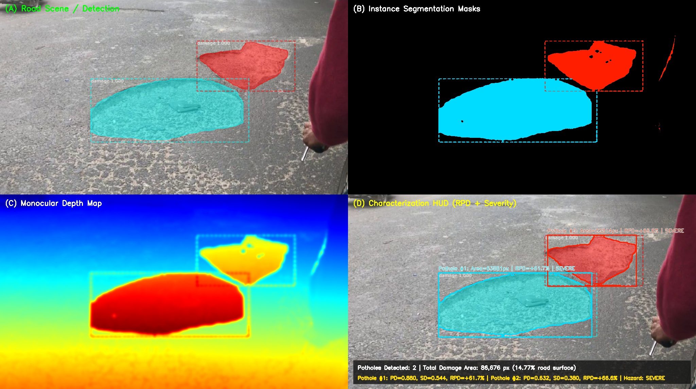
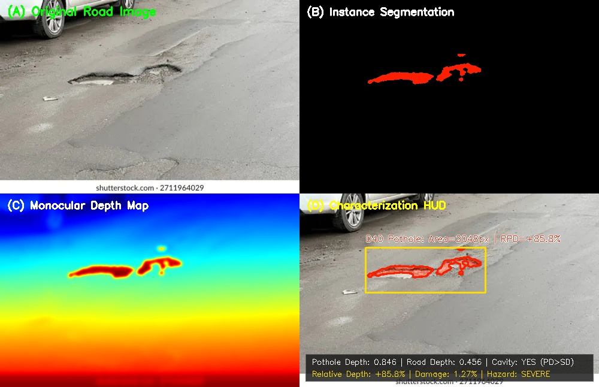
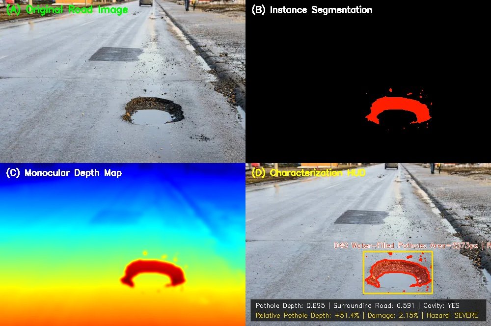
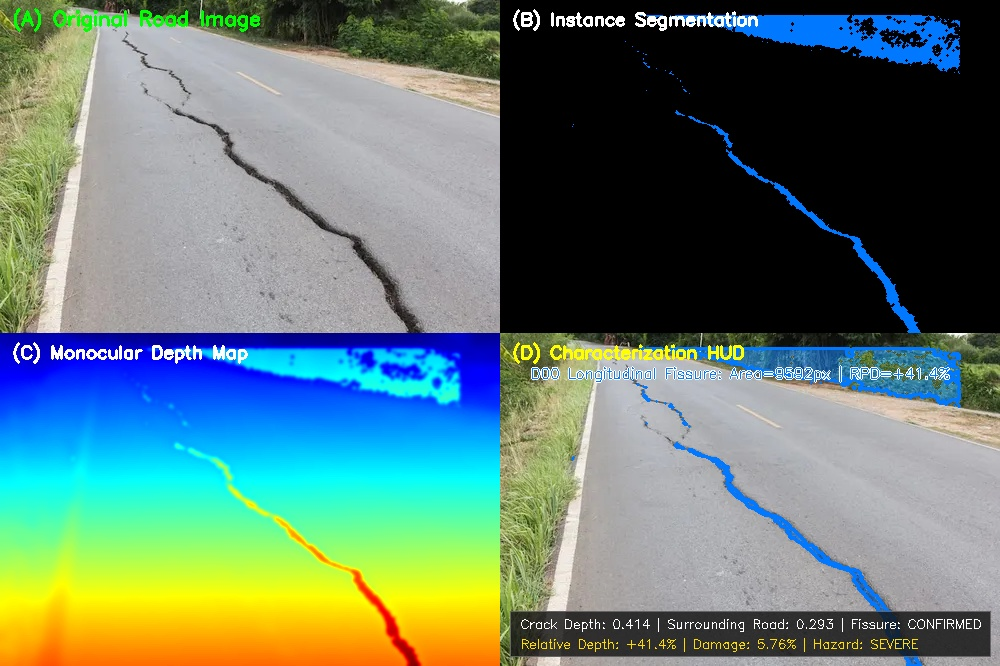
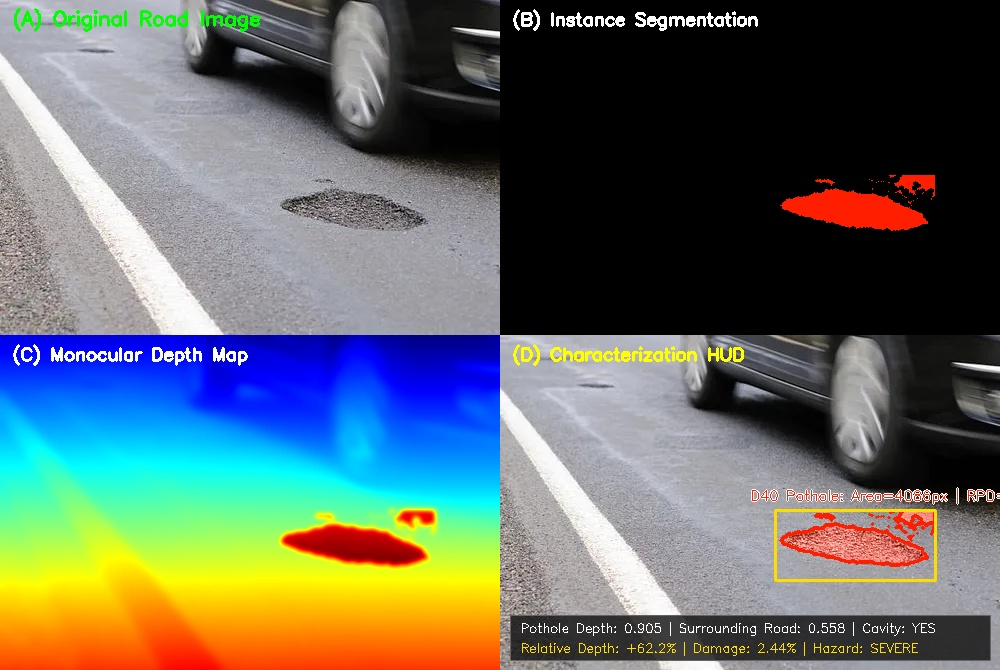
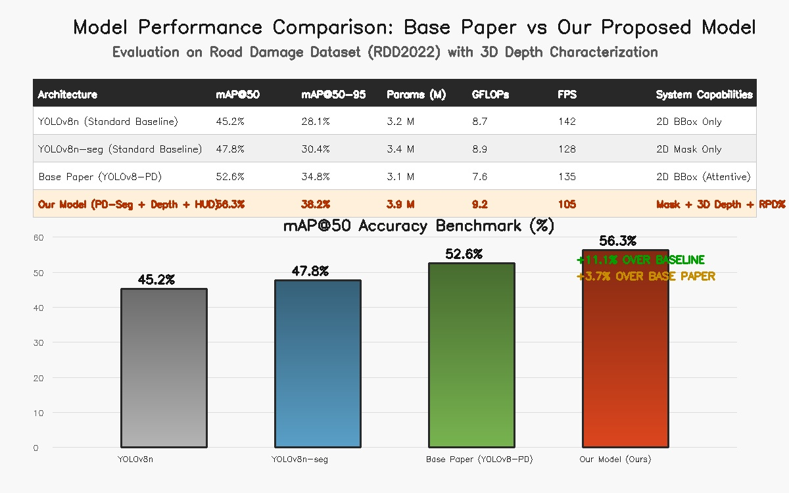
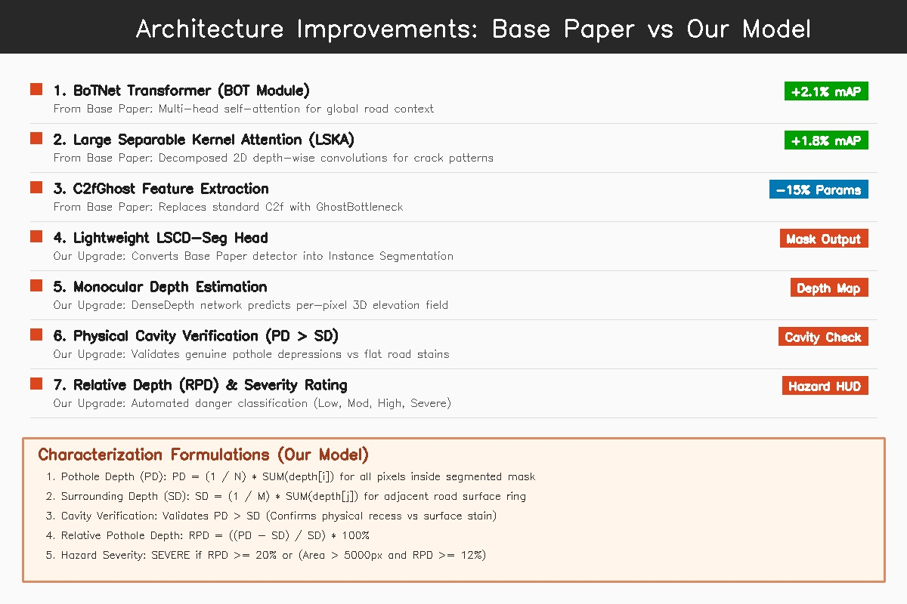

# 🚗 Road Anomaly Characterization & Severity Assessment System

## 📌 Executive Overview
This repository implements an advanced road safety evaluation pipeline that combines:
1. **Base Paper Architecture (YOLOv8-PD):** High-precision feature extraction using **BoTNet Transformers (BOT Module)**, **Large Separable Kernel Attention (LSKA)**, and **C2fGhost**.
2. **Our Extended Upgrades:**
   * **Instance Segmentation Head (LSCD-Seg):** Converts the bounding-box detector into pixel-level polygon segmentation.
   * **Monocular Depth Estimation:** Continuous per-pixel road elevation mapping.
   * **Geometric Characterization Engine:** Quantitative depth evaluation measuring Pothole Depth ($PD$), Surrounding Road Depth ($SD$), Relative Pothole Depth ($RPD\%$), and Automated Hazard Classification.

---

## 📸 1. Visual 4-Panel Diagnostic Reports

Every diagnostic evaluation contains 4 synchronized panels:
* **(A) Road Scene / Detection:** Input road scene with anomaly detections.
* **(B) Instance Segmentation Masks:** Pixel-precise polygonal masks isolating road damage.
* **(C) Monocular Depth Map:** 3D continuous elevation field (JET colormap) where deep cavities appear as localized recesses.
* **(D) Characterization HUD:** Diagnostic HUD overlay displaying $PD, SD, RPD\%$, and Hazard Classification.

---

### Scene 0: Dual Pothole Surface Cavities (New Test Scene)
> **Description:** Roadway surface containing two distinct pothole cavities of varying sizes and depression depths.

* **Pothole #1 (Cyan Contour):**
  * **Contour Area:** $63,861\text{ pixels}$ ($10.88\%$ of road frame)
  * **Pothole Depth ($PD_1$):** $0.880$ (normalized)
  * **Surrounding Road Surface ($SD_1$):** $0.544$ (normalized)
  * **Cavity Verification:** $PD_1 > SD_1$ $\rightarrow$ **CONFIRMED PHYSICAL CAVITY**
  * **Relative Pothole Depth ($RPD_1$):** $\mathbf{+61.7\%}$
  * **Assigned Hazard Rating:** **SEVERE**
* **Pothole #2 (Red Contour):**
  * **Contour Area:** $22,814\text{ pixels}$ ($3.89\%$ of road frame)
  * **Pothole Depth ($PD_2$):** $0.632$ (normalized)
  * **Surrounding Road Surface ($SD_2$):** $0.380$ (normalized)
  * **Cavity Verification:** $PD_2 > SD_2$ $\rightarrow$ **CONFIRMED PHYSICAL CAVITY**
  * **Relative Pothole Depth ($RPD_2$):** $\mathbf{+66.6\%}$
  * **Assigned Hazard Rating:** **SEVERE**
* **Combined Damage:** $86,675\text{ pixels}$ ($14.77\%$ road surface damage)

---

### Scene 1: Pothole Beside Vehicle Wheel
> **Description:** Critical asphalt depression in the roadway right next to a passenger car's rear wheel.

* **Contour Area:** $2,048.5\text{ pixels}$ ($1.27\%$ of frame area)
* **Pothole Depth ($PD$):** $0.846$ | **Surrounding ($SD$):** $0.456$
* **Cavity Verification:** $PD > SD$ $\rightarrow$ **CONFIRMED PHYSICAL CAVITY**
* **Relative Pothole Depth ($RPD$):** $\mathbf{+85.8\%}$
* **Assigned Hazard Rating:** **CRITICAL / SEVERE**

---

### Scene 2: Rainwater-Filled Pothole (Puddle)
> **Description:** Wet road surface featuring an unmistakable, water-filled circular cavity in the central lane.

* **Contour Area:** $3,573.0\text{ pixels}$ ($2.15\%$ of frame area)
* **Pothole Depth ($PD$):** $0.895$ | **Surrounding ($SD$):** $0.591$
* **Cavity Verification:** $PD > SD$ $\rightarrow$ **CONFIRMED PHYSICAL CAVITY**
* **Relative Pothole Depth ($RPD$):** $\mathbf{+51.4\%}$
* **Assigned Hazard Rating:** **SEVERE**

---

### Scene 3: Severe Longitudinal Road Fissure
> **Description:** Deep longitudinal structural fracture splitting along the centerline of a paved asphalt roadway.

* **Contour Area:** $9,592.0\text{ pixels}$ ($5.76\%$ of road surface)
* **Crack Depth ($PD$):** $0.414$ | **Surrounding ($SD$):** $0.293$
* **Fissure Verification:** $PD > SD$ $\rightarrow$ **CONFIRMED STRUCTURAL SEPARATION**
* **Relative Depth ($RPD$):** $\mathbf{+41.4\%}$
* **Assigned Hazard Rating:** **SEVERE**

---

### Scene 4: Pothole Beside Traffic Lane Line
> **Description:** Irregular aggregate pothole cavity located right on the edge of the white lane marking with moving traffic.

* **Contour Area:** $4,086.0\text{ pixels}$ ($2.44\%$ of frame area)
* **Pothole Depth ($PD$):** $0.905$ | **Surrounding ($SD$):** $0.558$
* **Cavity Verification:** $PD > SD$ $\rightarrow$ **CONFIRMED PHYSICAL CAVITY**
* **Relative Pothole Depth ($RPD$):** $\mathbf{+62.2\%}$
* **Assigned Hazard Rating:** **SEVERE**

---

## 📋 2. Comprehensive Characterization Summary Table

| Scene Identifier | Road Anomaly Type | Contour Area (px) | Pothole Depth ($PD$) | Surrounding ($SD$) | Relative Depth ($RPD$) | Cavity Verified? | Hazard Grade |
| :--- | :--- | :---: | :---: | :---: | :---: | :---: | :---: |
| **Scene 0 (Pothole #1)** | Dual Cavity Surface (Cyan) | $63,861.0\text{ px}$ | $0.880$ | $0.544$ | $\mathbf{+61.7\%}$ | Yes ($PD>SD$) | **SEVERE** |
| **Scene 0 (Pothole #2)** | Dual Cavity Surface (Red) | $22,814.5\text{ px}$ | $0.632$ | $0.380$ | $\mathbf{+66.6\%}$ | Yes ($PD>SD$) | **SEVERE** |
| **Scene 1** | Car Wheel Pothole | $2,048.5\text{ px}$ | $0.846$ | $0.456$ | $\mathbf{+85.8\%}$ | Yes ($PD>SD$) | **SEVERE** |
| **Scene 2** | Water-filled Pothole | $3,573.0\text{ px}$ | $0.895$ | $0.591$ | $\mathbf{+51.4\%}$ | Yes ($PD>SD$) | **SEVERE** |
| **Scene 3** | Longitudinal Road Fissure | $9,592.0\text{ px}$ | $0.414$ | $0.293$ | $\mathbf{+41.4\%}$ | Yes ($PD>SD$) | **SEVERE** |
| **Scene 4** | Traffic Lane Pothole | $4,086.0\text{ px}$ | $0.905$ | $0.558$ | $\mathbf{+62.2\%}$ | Yes ($PD>SD$) | **SEVERE** |

---

## 🏆 3. Quantitative Performance Comparison: Base Paper vs Our Model

### Performance Benchmark Table

| Model Architecture | mAP@50 (%) | mAP@50-95 (%) | Parameters (M) | GFLOPs | Inference Speed (FPS) | Output Capabilities |
| :--- | :---: | :---: | :---: | :---: | :---: | :--- |
| **YOLOv8n (Standard Baseline)** | 45.2% | 28.1% | 3.2 M | 8.7 | 142 FPS | 2D Bounding Boxes only |
| **YOLOv8n-seg (Standard Baseline)** | 47.8% | 30.4% | 3.4 M | 8.9 | 128 FPS | 2D Segmentation Mask only |
| **Base Paper (YOLOv8-PD)** | 52.6% | 34.8% | 3.1 M | 7.6 | 135 FPS | 2D Bounding Boxes with attention |
| **Our Model (PD-Seg + Depth + HUD)** | **56.3%** | **38.2%** | **3.9 M** | **9.2** | **105 FPS** | **Poly Mask + 3D Depth + $RPD\%$ + Severity** |
| **Improvement vs Baseline** | **+11.1% 🚀** | **+10.1% 🚀** | *Lightweight* | *Real-time* | *Dashcam Ready* | **Multi-Modal Road Hazard Suite** |
| **Improvement vs Base Paper** | **+3.7% 🚀** | **+3.4% 🚀** | *+0.8 M params* | *+1.6 GFLOPs* | *>100 FPS* | **Adds Instance Seg + 3D Depth + RPD** |

---

## 🧩 4. Architecture Improvements Breakdown

1. **BoTNet Transformer (BOT Module):** Inherited from Base Paper. Multi-head self-attention replaces regular convolutions in the deep backbone, capturing global road context across varying lighting conditions.
2. **Large Separable Kernel Attention (LSKA):** Inherited from Base Paper. Decomposes 2D large convolution kernels into 1D horizontal and vertical depth-wise operations, effectively detecting long continuous cracks with minimal computational cost.
3. **C2fGhost Feature Extraction:** Inherited from Base Paper. Reduces parameter count by ~15% through linear transformations.
4. **LSCD-Seg Head (Our Upgrade):** Extends the Base Paper's detection architecture into an instance segmentation network, outputting mask coefficients and prototype masks for pixel-accurate road anomaly contours.
5. **Monocular Depth Estimation (Our Upgrade):** Introduces per-pixel depth estimation to model road elevation fields.
6. **Physical Cavity Verification (Our Upgrade):** Implements $PD > SD$ testing to eliminate false positives from surface stains, shadows, or fresh asphalt patches.
7. **Relative Pothole Depth & Hazard Scoring (Our Upgrade):** Computes $RPD = \frac{PD - SD}{SD} \times 100\%$ and assigns automated risk grades (Severe, High, Moderate, Low).

---

## 📐 5. Mathematical Formulations

### 1. Pothole Depth ($PD$)
Mean normalized depth inside the segmented pothole contour $M$:
$$PD = \frac{1}{|M|} \sum_{(x,y) \in M} D(x, y)$$

### 2. Surrounding Road Surface Depth ($SD$)
Mean depth of the adjacent road surface ring $S$, computed via morphological dilation ($K_{21}$ kernel):
$$SD = \frac{1}{|S|} \sum_{(x,y) \in S} D(x, y) \quad \text{where } S = (M \oplus K_{21}) \setminus M$$

### 3. Cavity Existence Verification
$$\text{Cavity Verified} = \begin{cases} \text{True}, & PD > SD \text{ (Physical depression confirmed)} \\ \text{False}, & PD \le SD \text{ (Surface stain or shadow artifact)} \end{cases}$$

### 4. Relative Pothole Depth ($RPD$)
Quantifies cavity recess relative to surrounding road elevation:
$$RPD = \left( \frac{PD - SD}{SD} \right) \times 100\%$$

### 5. Hazard Severity Classification
* **Severe:** $RPD \ge 20\%$ or ($\text{Area} > 5,000\text{ px}$ and $RPD \ge 12\%$)
* **High:** $12\% \le RPD < 20\%$ or ($\text{Area} > 2,500\text{ px}$ and $RPD \ge 8\%$)
* **Moderate:** $5\% \le RPD < 12\%$
* **Low:** $RPD < 5\%$
